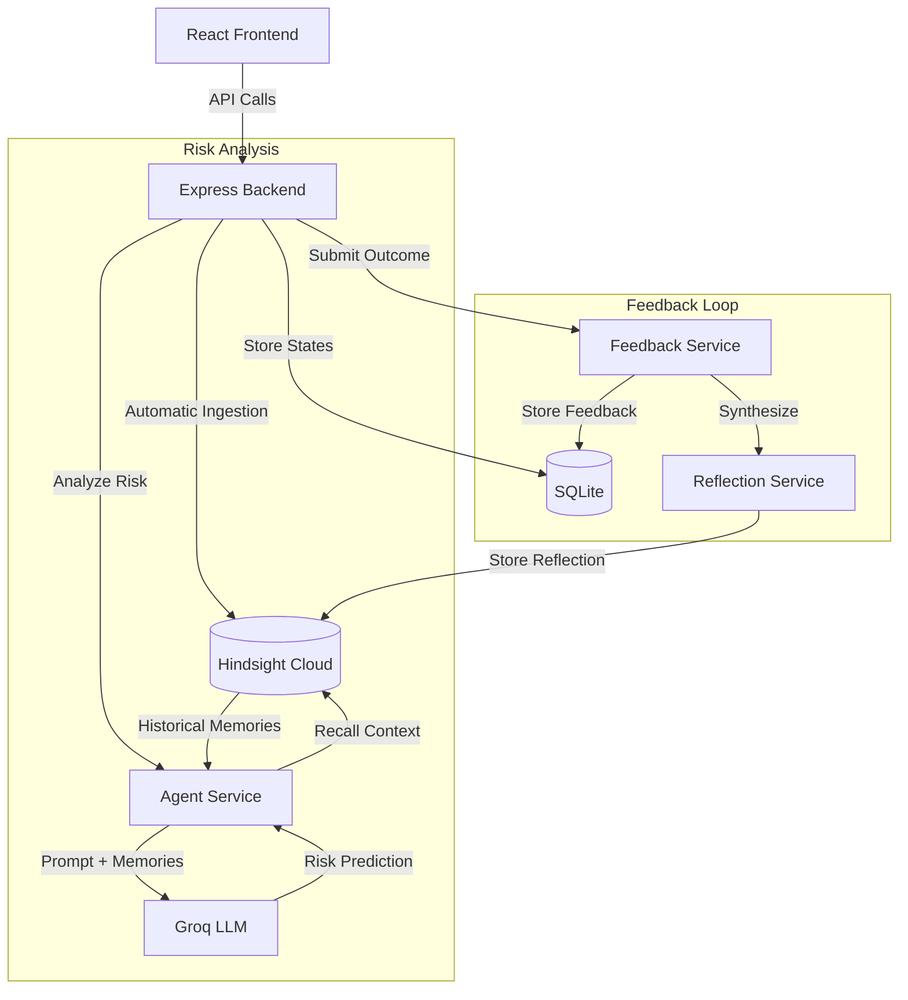

# DeployMind

DeployMind is an AI DevOps Pipeline Agent that remembers deployment history, build/deployment failures, infrastructure changes, incidents, and outcomes to identify historical patterns and provide safer deployment recommendations.

## Overview
By leveraging Hindsight Cloud as a persistent semantic memory layer, DeployMind remembers the full context of every deployment—including its configuration changes, its final outcome, and the specific root causes reported by engineers. Before executing a new deployment, DeployMind automatically recalls relevant historical failures and feeds that context into a large language model (Groq) to intelligently predict the risk level of the upcoming deployment. 

## Problem
Modern DevOps environments involve rapid changes across deeply interconnected services. When a deployment fails due to a configuration oversight (e.g., misaligned container memory limits, database connection pool exhaustion, or cascading timeout issues), the resolution is often documented in isolated incident tickets or slack channels. Weeks or months later, another engineer might unknowingly repeat the exact same configuration mistake. DeployMind solves this by creating an automated, intelligent memory layer that explicitly warns engineers when they are about to repeat a historical failure pattern.

## Key Features
- **Service Management:** Track microservices and their deployment lifecycles.
- **Deployment History:** Record metadata, versioning, environment state, and configuration changes for every deployment.
- **Incident & Infrastructure Tracking:** Log incidents and associate configuration changes with specific failures.
- **Automatic Memory Ingestion:** Seamlessly transforms API payloads into natural-language memories stored in Hindsight Cloud.
- **Semantic Historical Memory Recall:** Retrieves past patterns based on the context of a new deployment.
- **AI Deployment Risk Analysis:** Integrates Hindsight recall with Groq LLM reasoning to evaluate risk and generate actionable recommendations.
- **Engineer Feedback Loop:** Engineers can submit the actual outcome (SUCCESS, FAILED, ROLLED_BACK, NO_ISSUE) and root cause of a deployment.
- **Reflection Generation:** Automatically generates a synthesized reflection of the outcome and persists it to Hindsight for future learning.
- **Historical Backtesting:** Evaluates the agent's risk detection performance against completed historical deployments using a deterministic scorecard.
- **Frontend Dashboard:** A professional React-based interface to visualize risk analysis, deployment flow, and evaluation metrics.

## How It Works

The intelligence of DeployMind relies on a continuous feedback loop:

**Current Deployment**
→ Stored in SQLite
→ Automatic Memory Ingestion
→ Hindsight Cloud 
→ Semantic Recall 
→ Historical Context 
→ Groq Reasoning 
→ **Risk Analysis Prediction** 
→ Actual Outcome 
→ Engineer Feedback 
→ Reflection 
→ Hindsight 
→ Future Risk Analysis

DeployMind does not rely on static rules; it relies purely on the historical evidence returned by Hindsight semantic recall.

## Architecture



## Tech Stack
- **Frontend:** React, Vite, Tailwind CSS (v4), React Router, Lucide React
- **Backend:** Node.js, Express.js
- **Database:** SQLite (using better-sqlite3)
- **Persistent Memory:** Hindsight Cloud (@vectorize-io/hindsight-client)
- **LLM Reasoning:** Groq (groq-sdk)
- **HTTP Client:** Axios

## Project Structure

```
deploymind/
├── backend/
│   ├── data/                 # SQLite database storage (excluded from git)
│   ├── src/
│   │   ├── controllers/      # API route controllers
│   │   ├── db/               # Database initialization and schema
│   │   ├── routes/           # Express router definitions
│   │   ├── services/         # Core business logic (Agent, LLM, Hindsight, etc.)
│   │   └── server.js         # Backend entry point
│   ├── .env                  # Backend environment variables
│   └── package.json
└── frontend/
    ├── src/
    │   ├── api/              # Axios API bindings
    │   ├── components/       # Reusable React UI components
    │   ├── pages/            # Page-level components (Overview, Deployments, Evaluation)
    │   ├── App.jsx           # React Router setup
    │   └── index.css         # Tailwind CSS entry
    ├── vite.config.js
    └── package.json
```

## Getting Started

### Prerequisites
- Node.js (v18+)
- npm or yarn
- A [Hindsight Cloud](https://hindsight.vectorize.io/) API Key
- A [Groq](https://console.groq.com/) API Key

### Backend Installation
```bash
cd backend
npm install
```

### Frontend Installation
```bash
cd frontend
npm install
```

### Environment Variables
Create a `.env` file inside the `backend/` directory. **Never commit this file.**

```env
PORT=5000
HINDSIGHT_BASE_URL=https://api.hindsight.vectorize.io
HINDSIGHT_BANK_ID=deploymind-bank
HINDSIGHT_API_KEY=your_hindsight_api_key
GROQ_API_KEY=your_groq_api_key
```

### Running the Application

1. **Start the Backend**
```bash
cd backend
npm run dev
```
*The SQLite database will be automatically initialized in `backend/data/database.sqlite` on first run.*

2. **Start the Frontend**
```bash
cd frontend
npm run dev
```

Open `http://localhost:5173` in your browser.

## API Endpoints

The backend currently exposes the following REST APIs:

- **Health:** `GET /api/health`
- **Services:** `GET /api/services`, `POST /api/services`
- **Deployments:** `GET /api/deployments`, `POST /api/deployments`, `GET /api/deployments/:id`
- **Incidents:** `GET /api/incidents`, `POST /api/incidents`
- **Infrastructure Changes:** `GET /api/infrastructure-changes`, `POST /api/infrastructure-changes`
- **Memory Testing:** `POST /api/memory/retain`, `POST /api/memory/recall`
- **Agent/Intelligence:** 
  - `POST /api/agent/analyze-deployment`
  - `POST /api/agent/test-llm`
  - `POST /api/agent/backtest`
- **Feedback:** `POST /api/feedback`, `GET /api/feedback/:deploymentId`, `GET /api/feedback`

## Evaluation

DeployMind includes a built-in deterministic evaluation engine to measure its risk detection performance. The backtest runs historical deployments through the Groq analysis loop without exposing the actual outcomes to the model, protecting against data leakage.

**Current Evaluation Results:**
- The evaluation dataset is currently populated with completed historical failures.
- The latest backtest successfully detected **100% of historical failures** (5 out of 5 risk detections).
- **Important Limitation:** Because the current historical dataset does not yet contain successful or "no-issue" deployments, *safe-prediction performance and false-alarm rates cannot be measured at this time*.
- The generated `riskScore` is an arbitrary numerical weighting by the LLM indicating risk severity; it is not a statistical probability.

DeployMind does *not* claim 100% overall accuracy in a production environment. The current metrics solely reflect its ability to recognize catastrophic patterns stored in the limited demonstration dataset.

## Demo Flow

To observe the intelligence loop in action:
1. Open the **Overview** dashboard to see system health and stats.
2. Navigate to **Deployments** and select a recent deployment.
3. Click **Analyze Risk**. DeployMind will fetch historical context from Hindsight, feed it into Groq, and display the AI's risk recommendation.
4. Simulate the deployment's completion by filling out the **Deployment Outcome** feedback form at the bottom of the analysis (e.g., mark it as `FAILED` with a specific root cause).
5. Submit the form to generate a **Reflection**. This synthesizes the prediction vs. outcome and stores it in Hindsight.
6. Create a future deployment with a similar configuration mistake. When analyzed, Groq will retrieve the reflection and explicitly warn you based on that past failure.
7. Navigate to **Evaluation** to run a backtest and view the scorecard.

## Limitations
- **Groq API Rate Limits:** The free/on-demand tier of Groq imposes strict token-per-day rate limits. If exceeded, the backend will return a clean HTTP 429 error, and the frontend will display a safe unavailability message without locking the UI.
- **Data Dependency:** DeployMind's intelligence is entirely dependent on the quality and volume of historical memory stored in Hindsight. If no relevant memories exist, it cannot predict configuration risks.
- **Database Architecture:** The local SQLite implementation is designed specifically for this standalone demonstration and is not suitable for a distributed production cluster.

## Security
- All external integrations (Groq, Hindsight) require API keys.
- **Secrets must never be committed.** Keys must be stored in the local `.env` files, which are strictly ignored by `.gitignore`.

## Future Improvements
- Dockerization of the application for easier deployment.
- Implementation of an authentication/authorization layer for secure access.
- Migration to PostgreSQL for production readiness.
- Expanding the historical dataset to evaluate false-alarm rates accurately.
